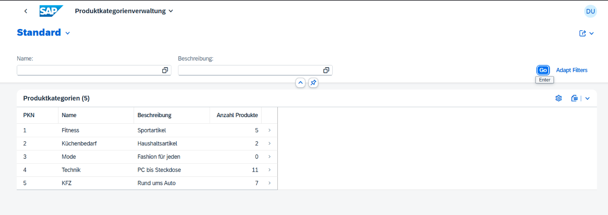
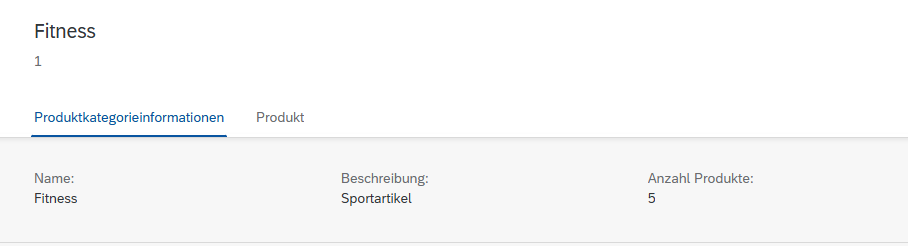
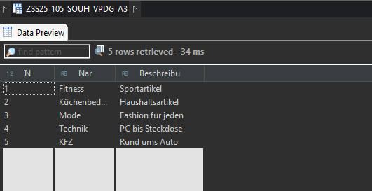

# 📚 SAP Produktkategorienverwaltung — ABAP & Fiori Elements

> **Studienprojekt im Modul „Kommerzielle Standardsoftware“**  
> Technische Hochschule Mittelhessen (THM) · Wirtschaftsinformatik (B.Sc.) · Sommersemester 2025

## 🎯 Projektübersicht

Im Rahmen eines Hochschulprojekts habe ich eine SAP-basierte Anwendung zur **Verwaltung und Anzeige von Produktkategorien und zugehörigen Produkten** umgesetzt und dokumentiert. Dazu wurden Datenbanktabellen und ABAP-Programme erstellt, **CDS Views** modelliert, ein **OData-V4-Service** bereitgestellt und eine **SAP Fiori elements List Report App** erzeugt.

Der dokumentierte Entwicklungsstand zeigt vor allem eine **lesende Fiori-Anwendung** zur Anzeige, Suche und Navigation. Eine vollständige produktiv nutzbare CRUD-Anwendung oder die spätere Statusvisualisierung ist mit den verfügbaren Unterlagen nicht nachgewiesen.

## 🏗️ Architektur

```text
ABAP Dictionary (SAP-System)
├── ZSS25_105_SOUH_G    → Tabelle: Produktkategorien
└── ZSS25_105_SOUH_P    → Tabelle: Produkte (PKN als Fremdschlüssel)
        │
        ▼
CDS View Layer
├── Basic Views        → Tabellenzugriff, LEFT OUTER JOIN, COUNT
├── Reuse / Root Views → Kategorie-Produkt-Beziehung
└── Consumption Views  → Projektion für die Anwendung
        │
        ▼
Service Definition + OData V4 UI Service Binding
        │
        ▼
SAP Fiori elements (List Report + Object Page)
        └── UI-Anpassung durch Metadata Extension / Annotations
```

Das Datenmodell besteht aus einer **1:n-Beziehung** zwischen Produktkategorien und Produkten. Die Kategorie wird über einen Schlüssel (`PKN`) referenziert.

## 🛠️ Technologien

| Technologie | Verwendung im Projekt |
|---|---|
| **ABAP** | Programm zur Befüllung der Tabellen mit Beispieldaten |
| **ABAP Dictionary** | Domänen, Datenelemente, Datenbanktabellen und Schlüssel |
| **ABAP CDS Views** | Datenmodellierung, LEFT OUTER JOIN und Aggregation |
| **SAP Fiori elements** | Generierter List Report und Detailansicht (Object Page) |
| **OData V4** | UI-Service zwischen SAP-Backend und Fiori-App |
| **Eclipse / ABAP Development Tools** | Backend- und CDS-Entwicklung |
| **Visual Studio Code / SAP Fiori tools** | Generierung und Konfiguration der Fiori-App |
| **SAP GUI** | Prüfung von Repository-Objekten und Daten |

## ✨ Nachgewiesene Funktionen

- ✅ **Produktkategorien anzeigen** — Übersicht mit Kategoriename, Beschreibung und Anzahl der Produkte
- ✅ **Kategorien suchen / filtern** — entsprechende Eingabefelder im List Report
- ✅ **Details einer Kategorie anzeigen** — Object Page mit Stammdaten
- ✅ **Produkte zuordnen** — relationale Verbindung zwischen Kategorien und Produkten
- ✅ **Produkte pro Kategorie zählen** — CDS View mit LEFT OUTER JOIN und Aggregation
- ✅ **OData-V4-Service bereitstellen** — Service Definition und Service Binding dokumentiert
- ✅ **UI-Metadaten anpassen** — List Report und Object Page über Annotationen

> **Abgrenzung:** In der bereitgestellten Projektdokumentation sind die Arbeiten bis zur Bearbeitung der XML-Annotationen beschrieben. Die zusätzliche Statuskennzeichnung aus einer folgenden Übung sowie allgemeines Anlegen, Bearbeiten und Löschen von Datensätzen über die UI sind hier nicht als abgeschlossen belegt.

## 🗃️ Vereinfachtes Datenmodell

```text
Produktkategorie: ZSS25_105_SOUH_G
  MANDT          → Mandant (Schlüssel)
  PKN            → Produktgruppen-ID (Schlüssel)
  PK_NAME        → Kategoriename
  BESCHREIBUNG   → Kategorie-Beschreibung
  ...            → Zeitstempel- und Verwaltungsfelder

Produkt: ZSS25_105_SOUH_P
  MANDT          → Mandant (Schlüssel)
  PNR            → Produktnummer (Schlüssel)
  PKN            → Verweis auf Produktkategorie
  NAME           → Produktname
  MARKE          → Marke
  PREIS          → Preis
  ...            → Änderungszeitstempel
```

Die Dokumentation zeigt **5 Produktkategorien und 25 Beispieldatensätze** in der Produkttabelle.

## 🚀 Umsetzungsschritte

1. Domänen und Datenelemente für Kategorie- und Produktnummern erstellen.
2. Zwei Datenbanktabellen im ABAP Dictionary definieren und Schlüsselbeziehungen anlegen.
3. Beispieldaten mit einem ABAP-Programm in die Tabellen einfügen.
4. CDS Views zur Anzeige der Tabellen und zur Anzahlberechnung je Produktkategorie entwickeln.
5. Reuse- und Consumption-Views für die Beziehung zwischen Kategorien und Produkten erstellen.
6. Consumption-Views über Service Definition und **OData V4 – UI** Binding bereitstellen.
7. Fiori-List-Report-App erzeugen und Darstellung über Metadatenerweiterungen/Annotationen anpassen.

## 📸 Screenshots

### Fiori List Report — Produktkategorien



### Object Page — Detailansicht



### CDS View — Datenvorschau



## 📁 Repository-Struktur

```text
sap-abap-fiori-product-catalog/
├── README.md                           # Deutsche Projektübersicht
├── README_EN.md                        # English project overview
├── .gitignore
├── docs/
│   ├── implementation-summary.md        # Erläuterung zur Umsetzung
│   └── publishing-checklist.md          # Hinweise zur Veröffentlichung
└── screenshots/
    ├── fiori-list-report.png
    ├── fiori-object-page.png
    └── cds-data-preview.png
```

## 💻 Quellcode und Ausführbarkeit

Aktuell enthält das Repository eine **Projektdokumentation mit ausgewählten echten Screenshots**, aber noch **keinen exportierten Original-ABAP- oder CDS-Quellcode** und **keinen VS-Code-Projektordner**. Der Originalcode wird erst ergänzt, wenn die entsprechenden Dateien vorliegen und für die Veröffentlichung freigegeben sind.

Die Anwendung benötigt zum Ausführen eine entsprechend konfigurierte, berechtigte **SAP-Entwicklungsumgebung**; die Screenshots allein stellen keine lauffähige Anwendung dar.

## 👨‍💻 Über das Projekt

**Fach:** Kommerzielle Standardsoftware (WK1103)  
**Studium:** Wirtschaftsinformatik, Technische Hochschule Mittelhessen  
**Schwerpunkt:** SAP-Entwicklung, ABAP, CDS-Datenmodellierung, OData und Fiori

---

[🇬🇧 English version](README_EN.md)
