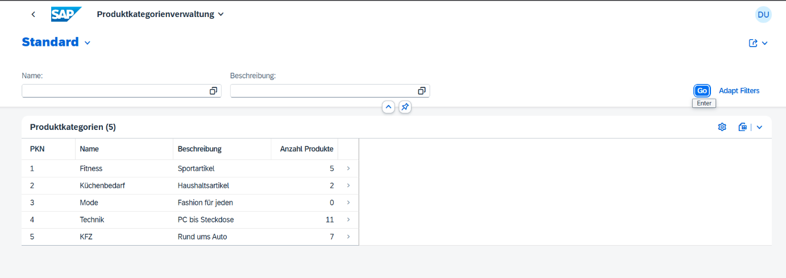
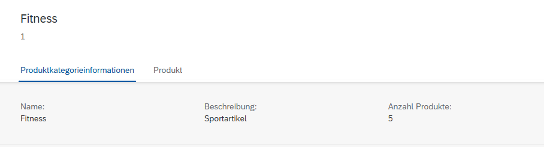
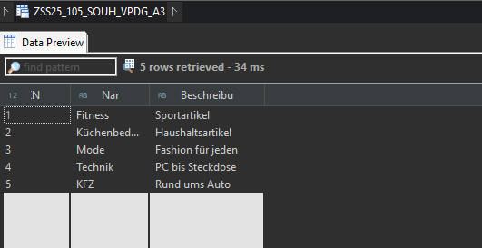
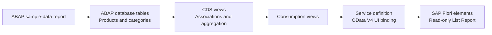

# SAP ABAP & Fiori Product Catalog

**Academic case study | Commercial Standard Software (KSW) | Summer Semester 2025**

An educational SAP application for browsing product categories and their products. The documented solution combines ABAP data modeling, Core Data Services (CDS), an OData V4 UI service, and a generated SAP Fiori elements List Report.

> **Portfolio status:** This repository currently contains an overview and selected screenshots from my project documentation. The original ABAP/CDS sources and Visual Studio Code application folder have **not yet been added**. Therefore, this is a documented project showcase, **not** a standalone runnable application. A SAP backend would be required to run the original solution.

## Screenshots

**Product categories - Fiori List Report**

**Category detail - Object Page**

**CDS View - data preview**

## Implemented and documented components

- **ABAP Dictionary:** Domains, data elements and two tables for products and product categories, including key and foreign-key relationships.
- **ABAP programming:** A report to insert educational sample data into the database tables; the documentation shows a table containing 25 products.
- **CDS data modeling:** Views for both tables and a left outer join for counting the products assigned to each category.
- **Data model for the application:** Root/reuse and consumption views with product/category associations.
- **Service exposure:** Service definition and **OData V4 - UI** service binding.
- **SAP Fiori elements:** Generated read-only List Report and category Object Page, plus metadata extension and annotation work.
- **Development tools:** Eclipse with ABAP Development Tools, SAP GUI, Visual Studio Code / SAP Fiori tools.

The submitted documentation covers the implementation through the XML annotation work in task 5.2. Further features from subsequent tasks, such as criticality colors and status icons, are **not verified** by the available documents and are not claimed here.

## High-level architecture

## Data model (simplified)

- **Product category:** Category identifier, name, description and administrative fields.
- **Product:** Product identifier, category identifier, name, brand, price and change timestamp.
- **Relation:** Products reference product categories by category identifier.

## Repository contents

- `screenshots/` - selected project screenshots, cropped to avoid publishing SAP login screens.
- `docs/implementation-summary.md` - description of the implementation and its evidence.
- `docs/publishing-checklist.md` - instructions for adding real source files safely.

## Next steps

1. Export my own ABAP report, table definitions and CDS source files from the SAP development environment (where permitted).
2. Add the original Fiori app's VS Code project files after removing credentials, local connection settings, generated dependencies and build outputs.
3. Verify that the repository contains no usernames, student IDs, passwords, tokens, internal URLs or restricted university course materials.
4. Update this README to include a reproducible setup guide once source and configuration are available.

**Note:** The screenshots represent results documented in the original academic submission. This repository does not claim the application is currently publicly accessible.

[Deutsche Projektbeschreibung](README.md)
